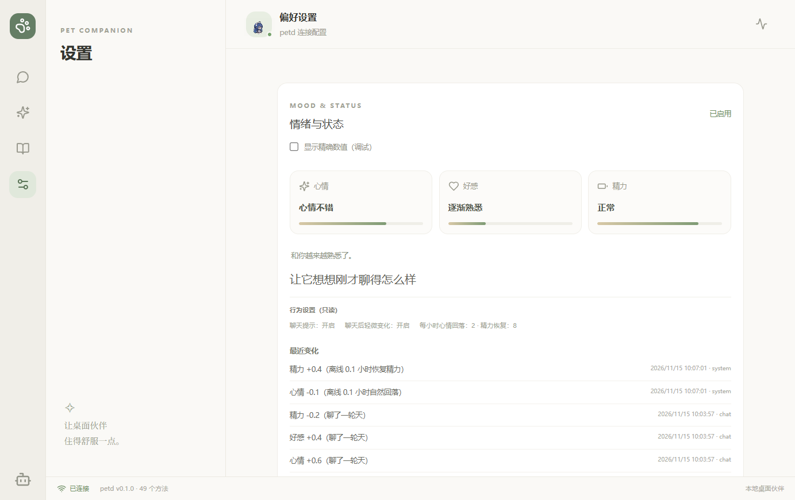

# @petd/pet-ui

Electron + React renderer for petd. UI/business state stays with petd; the renderer uses the loopback WebSocket gateway.

## Development

```powershell
pnpm install
pnpm --filter @petd/pet-ui dev
pnpm --filter @petd/pet-ui build
pnpm --filter @petd/pet-ui typecheck
pnpm --filter @petd/pet-ui test
```

The desktop shell includes a Vite renderer, Electron main entry and preload, a floating draggable pet window, tray controls, and a gateway status strip with reconnect delays (1s/2s/5s). Electron reads `gateway.json` and `token.json` from `%APPDATA%/dayu-pet/petd` (or `PETD_HOME`) in the main process and exposes only the connection bootstrap over narrow IPC methods. Click the pet to poke it without opening chat; press and move it to reposition it; use the right-click menu to open chat, hide, or quit. Pointer movement under 6px is a click; larger movement uses main-process cursor sampling to drag the window. The Windows pet window uses a compact native hit region around the character, so transparent margins pass mouse input to the app behind it. The pet uses the transparent idle animation from the local `dsh-pet` package with its 1/255 alpha fringe correction; source and artwork credit are recorded in `src/assets/README.md`.

Chat uses `session.list/get`, `session.create`, `chat.send`, and event-backed messages. The settings view reads only non-secret data from `config.get`. The persona view supports section edits through `persona.patch` with `expectedVersion`, AI edit locks, revision history, rollback, and `persona.changed` refresh handling. `E_CONFLICT` displays a refresh message and reloads the latest persona before further edits.

The Memory panel uses `memory.list/read/write/history/diff` and `blob.list/put/get/delete/preview`, with tree, Markdown preview, file history, local image thumbnails, text summaries, and chat attachment handles. The current petd branch still needs `memory.changed`, `memory.restore`, atomic memory write conflict parameters, and `memory.status.workspace`; see `docs/pet-ui-待接方法.md`. Until then, the UI performs a read-before-write conflict check and disables history restore with a clear pending-method message.

## M7 mood and status

Settings shows petd-backed mood, affection, energy, recent history, and read-only mood config. Exact values are hidden by default; the debug checkbox is stored in local UI preferences. The pet window displays only the idle portrait; a confirmed single click plays the bundled `dsh-pet` click sound, adds a short Q-bounce animation, and sends `mood.poke` without adding mood indicators or expression overlays. The settings view subscribes to `mood.changed` and reloads `mood.status` on reconnect; pet-ui does not calculate chat mood changes.

Mock coverage: `pnpm --filter @petd/pet-ui test` — 19 component checks passing.

Real petd smoke run (using `%TEMP%\petd-ui-dev`, not the default home): connected at `127.0.0.1:63826`, sent one `chat.send`, completed one `mood.evaluate`, and clicked the pet once to verify a `mood.poke` event updated the three rings. No additional model calls were made. The initial state and results persist in the temporary home.




## Screenshots and build evidence

Build: `pnpm --filter @petd/pet-ui build` — passing.
Tests: `pnpm --filter @petd/pet-ui test` — 19 component checks passing.

The chat-window UI and Electron main-process wiring are implemented. M7 smoke testing exercised one real chat generation, one mood evaluation, and a poke event against the isolated petd home above. The pet window uses the transparent idle animation from `dsh-pet`; Coopanion's full layered model and richer movement remain future visual polish.
